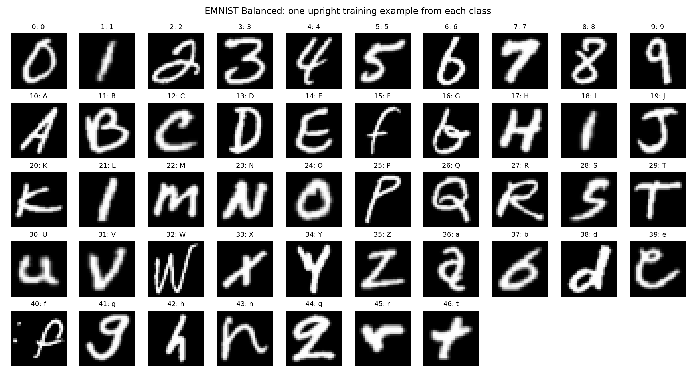

# EMNIST Models Code

This branch contains the Python source code used to prepare, train, validate, and compare neural network models for the EMNIST Balanced dataset as part of the dissertation:

**Machine Learning on the Edge: Performance and Security Evaluation of Artificial Neural Network Implementations in Embedded Systems**

The EMNIST experiments extended the original MNIST classification task from handwritten digits to 47 classes representing handwritten digits and letters.

The model-development process evaluated fully connected neural networks and convolutional neural networks (CNNs) before selecting a compact CNN for subsequent FPGA and Unity implementations.

This branch contains the model-development code. Training outputs, experimental notebooks, accuracy results, and supporting data are maintained separately in the corresponding notebook and data branch.

---

## EMNIST Balanced Dataset

The experiments used the EMNIST Balanced dataset, which contains:

- 112,800 training images;
- 18,800 test images;
- 47 balanced classification categories; and
- 28 × 28 grayscale images.

The official dataset is available from the National Institute of Standards and Technology (NIST):

https://www.nist.gov/itl/products-and-services/emnist-dataset

The dataset files are not included in this repository to avoid duplicating the original data.

The preparation scripts verify the dataset structure, correct the orientation of the original IDX images, and preserve the mapping between numeric labels and handwritten characters.

### EMNIST Balanced Class Examples



The figure shows one upright example from each of the 47 classification categories.

---

# Model Development

The initial experiments evaluated fully connected architectures similar to the network used for MNIST.

Additional experiments incorporated CNNs to examine spatial feature extraction and classification performance with the expanded character set.

The model-development sequence included:

```text
EMNIST Balanced Dataset
    ↓
Dataset Verification and Preparation
    ↓
Fully Connected Network Experiments
    ↓
CNN Reference Model
    ↓
Improved CNN
    ↓
Compact CNN
    ↓
Model Selection
    ↓
FPGA and Unity Adaptation
```

## Fully Connected Network Experiments

The initial experiments evaluated dense neural networks with different hidden-layer configurations.

The associated scripts include:

- `network2_emnist.py` — Neural network implementation supporting the earlier fully connected experiments.
- `emnist_loader.py` — Dataset loading, image orientation correction, and training/validation preparation.
- `train_emnist.py` — Initial fully connected training experiments.
- `train_emnist_expanded.py` — Expanded fully connected model experiment.
- `train_emnist_mlp_200.py` — 784–200–47 fully connected model.

These experiments supported the evaluation of model complexity and classification behavior before transitioning to convolutional architectures.

## CNN Experiments

The CNN experiments examined models with convolutional layers, ReLU activation, pooling, and fully connected classification.

The associated scripts include:

- `train_emnist_cnn_reference.py` — Initial CNN reference model.
- `train_emnist_cnn_improved.py` — Improved CNN using additional regularization and image augmentation.
- `train_emnist_compact_fpga_candidate.py` — Compact CNN developed for subsequent FPGA implementation.

The training procedures used separate training and validation partitions. The official test set remained independent of model selection.

---

# Selected Compact CNN

The selected architecture uses three convolutional layers with 16, 32, and 64 output channels, followed by global average pooling and a 47-class fully connected output layer.

The model architecture is:

```text
28 × 28 × 1 Input
    ↓
Conv 3 × 3 — 16 channels — ReLU
    ↓
Max Pool 2 × 2
    ↓
Conv 3 × 3 — 32 channels — ReLU
    ↓
Max Pool 2 × 2
    ↓
Conv 3 × 3 — 64 channels — ReLU
    ↓
Global Average Pooling
    ↓
Dense 47
    ↓
argmax prediction
```

The model contains **26,351 trainable parameters**.

The reference model produced:

```text
Validation accuracy: 87.10%

Test classifications:
16,327 / 18,800

Test accuracy:
86.85%
```

A larger CNN achieved higher classification accuracy, but the compact architecture was selected to reduce model complexity and support implementation on the available FPGA hardware.

The selected trained model provides the reference for the subsequent FPGA and Unity adaptations.

---

# Model Preparation and Supporting Scripts

The following scripts support dataset preparation and model evaluation:

- `emnist_balanced_verify.py` — Verifies the official EMNIST Balanced files, class mapping, image orientation, and dataset structure.
- `emnist_loader.py` — Loads and prepares EMNIST images for model development.
- `compare_emnist_cnn_quantization.py` — Examines the effects of reduced numerical precision on the trained CNN models.

The quantization comparison supported model-selection decisions before the development of integer arithmetic and hardware-specific inference.

The integer reference implementation, FPGA test-vector generation, and Verilog source are maintained separately with the FPGA implementation.

---

# Software Environment

Model development used Python and supporting numerical and machine learning libraries.

Primary dependencies include:

- Python;
- NumPy;
- PyTorch; and
- Matplotlib.

The corresponding `requirements.txt` identifies the software packages required by the model-development scripts.

The CNN training scripts used AdamW optimization, validation-based checkpoint selection, and limited image augmentation.

---

# Model Artifacts and Experimental Data

This code branch does not duplicate the complete training output directories.

The corresponding notebook and data branch preserves:

- training and validation histories;
- model checkpoints;
- classification accuracy results;
- confusion matrices;
- model comparisons;
- quantization comparison results;
- supporting experimental figures; and
- reproducibility notebooks.

The selected compact CNN checkpoint is retained with the model artifacts so that the FPGA and Unity implementations can use the same trained parameters.

The original EMNIST dataset is obtained separately from NIST.

---

# Subsequent Implementation

The selected CNN serves as the reference model for the FPGA and Unity experiments.

## FPGA Implementation

The FPGA implementation adapts the compact CNN to the ZedBoard's programmable logic.

The hardware-specific workflow includes:

```text
Trained Compact CNN
    ↓
Weight and Bias Conversion
    ↓
Integer Arithmetic Reference
    ↓
Verilog CNN Implementation
    ↓
Vivado Simulation
    ↓
Synthesis and Implementation
    ↓
ZedBoard Validation
```

The FPGA implementation code, converted parameters, test vectors, Vivado configuration, and hardware verification materials are maintained in separate FPGA branches.

## Unity Implementation

The Unity implementation adapts the trained CNN for execution on the Windows PC and Meta Quest 3S.

The corresponding branches document model conversion, Unity integration, CPU and GPU inference, and platform-specific evaluation.

These implementation branches reference the model-development work rather than duplicating the original training experiments.

---

# Reproducibility Notes

The scripts preserve the development progression from fully connected models to convolutional models and the selected compact CNN.

Some scripts represent earlier experiments rather than the final model. They are included to document the architecture-selection process.

Model training, validation, and hardware adaptation represent separate experimental stages. Numerical precision comparisons performed during model selection should not be interpreted as completed FPGA inference measurements.

The experimental notebooks and data branch provides the corresponding results and supporting evidence.

---

# Repository Scope

This branch contains:

- EMNIST dataset preparation code;
- fully connected model training scripts;
- CNN training scripts;
- model comparison code;
- supporting software dependencies; and
- the EMNIST Balanced class example figure.

This branch does not contain:

- original EMNIST dataset files;
- complete training output directories;
- FPGA Verilog source;
- Vivado project files;
- hardware-specific integer inference implementations;
- Unity application code; or
- experimental measurement notebooks.

These materials are maintained in their respective repository branches.

---

# Dissertation Context

This branch supports the EMNIST model development and validation described in the dissertation methodology and results chapters.

The repository preserves the source code used to develop the reference models.

The dissertation provides the formal discussion of model selection, classification accuracy, computational requirements, implementation differences, and cross-platform performance comparisons.

See the master repository README for the complete branch organization and experimental context.
